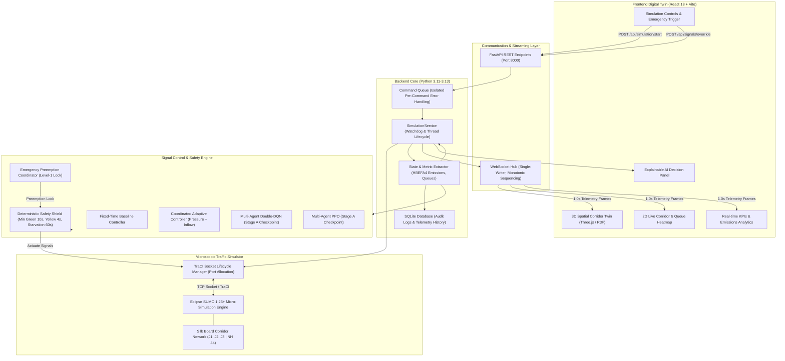
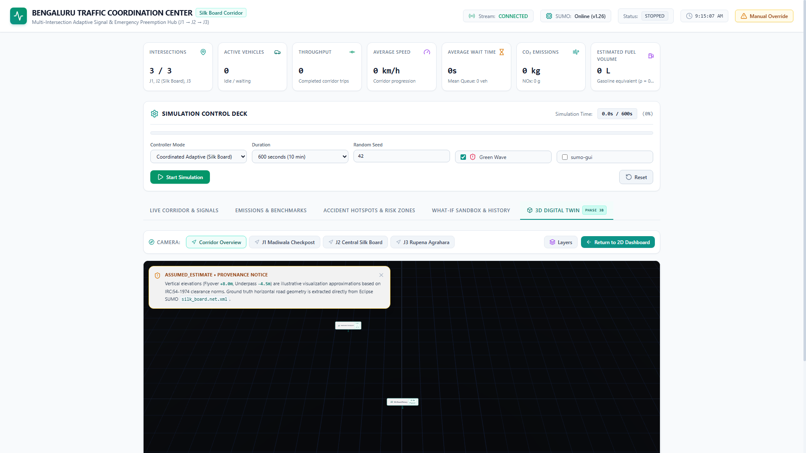
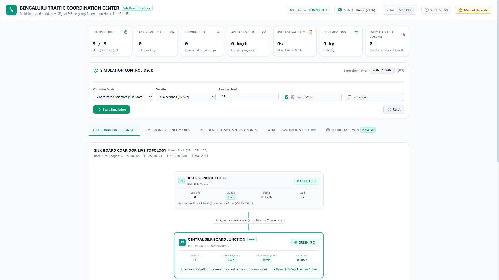
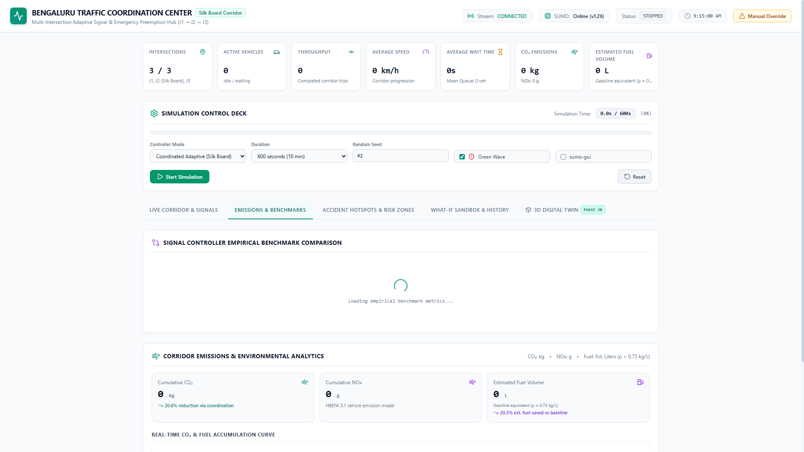
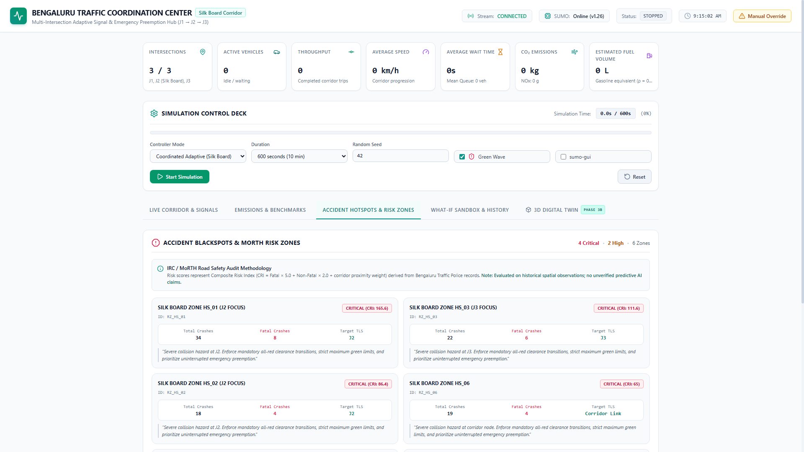

# Smart Traffic Coordination System — Bengaluru Silk Board Digital Twin & Intelligence Platform

[](https://www.python.org/)
[](https://eclipse.dev/sumo/)
[](https://fastapi.tiangolo.com/)
[](https://react.dev/)
[](https://threejs.org/)
[-brightgreen.svg)]()
[]()

An intelligent multi-intersection traffic signal coordination, microscopic simulation, and 3D digital twin platform modeled on the **Central Silk Board arterial corridor along Hosur Road (NH 44) in Bengaluru, Karnataka, India**.

The platform couples microscopic traffic simulation (**Eclipse SUMO / TraCI**) with multi-agent reinforcement learning (**Double-DQN**, **PPO**), classical coordinated algorithms (**Webster Optimal Split**, **Max-Pressure**, **NEMA Dual-Ring**), deterministic safety shields, Level-1 emergency vehicle preemption waves, and a 3D procedural WebGL digital twin rendered with **Three.js** and **React Three Fiber**.

---

## 1. Problem Statement & Motivation

The **Central Silk Board** junction in South Bengaluru is widely recognized as one of the most severe urban congestion bottlenecks in India. The junction serves as the primary convergence point connecting the Outer Ring Road (ORR / BTM Layout), HSR Layout, Electronic City, BTM 2nd Stage, and Hosur Road.

### Key Urban Challenges
1. **Bottleneck Convergence & Spillback:** High-density peak flows merge onto a constrained arterial corridor, causing localized queues at one intersection to rapidly spill back across upstream intersections.
2. **Uncoordinated Static Splits:** Conventional pre-timed signal controllers allocate static phase splits regardless of real-time queue accumulation, inducing severe arterial delays and shockwaves.
3. **Cross-Street Starvation:** Excessive arterial green extension starves secondary side streets, generating localized gridlock on feeder approaches.
4. **Emergency Vehicle Blockage:** Emergency response vehicles (ambulances, fire engines) encounter impassable congestion without automated green-wave preemption.

### Simulation-First Research Scope
This project models the Silk Board corridor in microscopic simulation to investigate how coordinated adaptive algorithms, multi-agent reinforcement learning, and deterministic safety mechanisms reduce cumulative vehicle delay, improve corridor throughput, and guarantee rapid emergency vehicle clearance.

> **Research Transparency Notice:** All experimental results reported in this repository are derived from simulated traffic environments using Eclipse SUMO. The road geometry is extracted from OpenStreetMap data. Physical hardware deployment, loop-detector integration, and real-world municipal field calibration remain future work.

---

## 2. Key Platform Features

- **Microscopic Traffic Simulation:** Powered by Eclipse SUMO 1.26+ with realistic Indian vehicle fleets (two-wheelers, cars, BMTC buses, commercial trucks, ambulances) adhering to Krauss car-following physics.
- **Multiple Signal Control Paradigms:**
  - *Fixed-Time Baseline:* Rigid pre-timed cycle plan based on historical Silk Board splits.
  - *Coordinated Adaptive Controller:* Dynamic queue-proportional phase allocation with inter-junction green-wave progression.
  - *Multi-Agent Double-DQN (Stage A):* Dueling value-based neural networks with discrete 3-action spaces and upstream inflow anticipation.
  - *Multi-Agent PPO (Stage A):* Clipped surrogate actor-critic policy with Generalized Advantage Estimation (GAE).
  - *Classical Baselines:* Webster Optimal Cycle/Split, Max-Pressure Network Control, and NEMA Actuated Control.
- **Deterministic Multi-Tier Safety Shield:**
  - *Minimum Green Enforcement ($15.0\text{ s}$):* Prevents rapid signal oscillation and phase chatter across all junctions ($J_1, J_2, J_3$).
  - *Mandatory Yellow Clearance ($4.0\text{ s}$ at $J_1/J_3$, $6.0\text{ s}$ at $J_2$):* Guarantees vehicle clearance before conflicting green onset, tailored to junction conflict geometry ($J_2$ conflict area requires $6.0\text{ s}$).
  - *Anti-Starvation Maximum Red Ceiling ($60.0\text{ s}$):* Guaranteed service for high-wait side-street approaches.
- **Level-1 Emergency Green-Wave Preemption:** Asynchronous preemption corridor locks oncoming signals to priority green, achieving rapid emergency vehicle clearance (verified at 45.0s transit time with 0 mid-corridor stops over a 500s simulation horizon in `tests/test_emergency_runtime_safety.py`).
- **Real-Time Streaming & Resilience:** FastAPI backend featuring a dedicated single-writer WebSocket hub, sequence number monotonicity, bounded per-client queues, and process watchdogs.
- **Interactive 3D Digital Twin:** Procedural 3D scene built with Three.js, React Three Fiber, and Tailwind CSS, rendering elevated flyovers, concrete piers, multi-lane road ribbons, dynamic vehicle meshes, and real-time 3-aspect signal heads.

---

## 3. System Architecture



---

## 4. Corridor Network & Junction Layout

The modeled corridor represents a critical $1.2\text{ km}$ stretch along **Hosur Road (National Highway 44)** in South Bengaluru, incorporating 3 signalized intersections and intermediate dual-carriageway arterial edges:

```
                  To Koramangala / BTM
                           │
                           ▼
 [North Inflow] ───► [ Junction J1 ] ◄─── [Cross Street: Madiwala]
                           │
                           ▼ (Hosur Road Spine: Edge 172853382#1)
 [Outer Ring Rd] ──► [ Junction J2 ] ◄─── [Cross Street: HSR Layout]
                           │ (Central Silk Board Core)
                           ▼ (Hosur Road Spine: Edge 172853382#2)
 [South Inflow] ───► [ Junction J3 ] ◄─── [Cross Street: Bommanahalli]
                           │
                           ▼
                  To Electronic City
```

- **Junction J1 ($J_1$ - North Node / Madiwala Checkpost):** Coordinates northern arterial inflows from Hosur Road and cross traffic from St. John's / Madiwala Market.
- **Junction J2 ($J_2$ - Core Hub / Central Silk Board Core):** Major 4-phase interchange handling heavy convergence from BTM Layout (Outer Ring Road West) and HSR Layout (Outer Ring Road East).
- **Junction J3 ($J_3$ - South Node / Bommanahalli Junction):** Manages southern outbound dispersal towards Electronic City Flyover and local industrial approach traffic.

---

## 5. Controller Architectures & Action Spaces

The platform provides a unified interface across classical, adaptive, and neural control paradigms:

| Controller | Architecture & Policy | Action Space ($\mathcal{A}$) | Key Parameters |
| :--- | :--- | :--- | :--- |
| **Fixed-Time Baseline** | Static pre-timed cyclic plan | Pre-determined phase progression | 90s fixed cycle, static splits |
| **Coordinated Adaptive** | Real-time queue backpressure with green-wave progression | Dynamic phase extension and switching | $k_{\text{inflow}} = 0.35$, offset synchrony |
| **Double-DQN (Stage A)** | Multi-Agent Dueling Q-Network (14-dim normalized state vector per junction) | Discrete 3-action: $\{0: \text{KEEP}, 1: \text{SWITCH}, 2: \text{EXTEND}\}$ | $\gamma = 0.95$, dueling streams, $\tau = 0.005$ |
| **PPO (Stage A)** | Multi-Agent Discrete Actor-Critic with GAE (14-dim normalized state vector per junction) | Discrete 3-action: $\{0: \text{KEEP}, 1: \text{SWITCH}, 2: \text{EXTEND}\}$ | Clip $\epsilon = 0.2$, $\lambda_{\text{GAE}} = 0.95$, entropy coef $0.01$ |
| **Webster Controller** | Classical delay-minimizing optimal split | Cyclic phase split adjustment | $C_{\text{opt}} = \frac{1.5L + 5}{1 - Y}$, saturation ratio $Y$ |
| **Max-Pressure** | Network-wide store-and-forward pressure gradient | Selects phase maximizing upstream-downstream delta | Pressure $P_m = \sum Q_{\text{in}} - \sum Q_{\text{out}}$ |
| **NEMA Dual-Ring** | Actuated phase gap-out and maximum green extension | Actuated passage extension / gap-out | Passage time $3.0\text{ s}$, max green ceiling |

### Neural Controller Architectures & Observation Spaces

Both neural controllers process a standardized 14-dimensional normalized observation vector $s_{i,t} \in \mathbb{R}^{14}$ at each junction $J_i$:

| Index | Feature Description | Normalization / Scaling | Operational Semantics |
| :---: | :--- | :--- | :--- |
| **[0]** | `current_phase_norm` | $\text{phase} / 3.0$ | Active signal phase index |
| **[1]** | `phase_elapsed_norm` | $\min(\text{elapsed} / 60.0, 1.0)$ | Continuous green elapsed time |
| **[2]** | `time_to_switch_norm` | $\min(\text{switch\_wait} / 60.0, 1.0)$ | Time remaining until maximum green |
| **[3]** | `can_switch_flag` | $1.0 \text{ if elapsed} \ge 15.0\text{ s else } 0.0$ | Minimum green constraint satisfied |
| **[4]** | `corridor_queue_norm` | $Q_{\text{corridor}} / 50.0$ | Arterial Hosur Road queue length |
| **[5]** | `side_queue_norm` | $Q_{\text{side}} / 50.0$ | Side-street approach queue length |
| **[6]** | `total_queue_norm` | $Q_{\text{total}} / 100.0$ | Total aggregate intersection queue |
| **[7]** | `average_speed_norm` | $v_{\text{avg}} / 16.67\text{ m/s}$ | Mean approach traffic speed |
| **[8]** | `waiting_time_norm` | $\min(W_{\text{wait}} / 300.0, 1.0)$ | Total accumulated waiting seconds |
| **[9]** | `vehicle_count_norm` | $\min(N_{\text{veh}} / 100.0, 1.0)$ | Active vehicle occupancy count |
| **[10]** | `co2_emissions_norm` | $\min(\text{CO}_{2} / 5000.0\text{ mg/s}, 1.0)$ | Instantaneous carbon emission rate |
| **[11]** | `upstream_inflow_norm`| $\min(\text{Inflow} / 20.0\text{ veh/s}, 1.0)$ | Anticipated arrival rate from upstream |
| **[12]** | `platoons_norm` | $\min(N_{\text{platoons}} / 5.0, 1.0)$ | Approaching coordinated vehicle platoons |
| **[13]** | `emergency_flag` | $1.0 \text{ if ambulance detected else } 0.0$ | Emergency priority preemption indicator |

For multi-intersection corridor coordination, the three junction vectors concatenate into a 42-dimensional unified corridor state: $S_{\text{corridor}} = [s_{J_1}, s_{J_2}, s_{J_3}] \in \mathbb{R}^{42}$.

#### Detailed Network Topologies
- **Dueling Double-DQN:**
  - *Shared Feature Extractor:* $\text{Input}(14) \to \text{FC1}(64, \text{ReLU}) \to \text{FC2}(64, \text{ReLU})$
  - *Value Stream:* $\text{FC}(32, \text{ReLU}) \to \text{FC}(1) \implies V(s)$
  - *Advantage Stream:* $\text{FC}(32, \text{ReLU}) \to \text{FC}(3) \implies A(s, a)$
  - *Aggregation:* $Q(s, a) = V(s) + \left(A(s, a) - \frac{1}{3}\sum_{a'=0}^{2} A(s, a')\right)$
- **PPO Actor-Critic:**
  - *Shared Representation:* $\text{Input}(14) \to \text{FC1}(64, \text{ReLU}) \to \text{FC2}(64, \text{ReLU})$
  - *Actor Policy Head:* $\text{FC}(32, \text{ReLU}) \to \text{FC}(3) \to \text{Softmax} \implies \pi(a|s)$
  - *Critic Value Head:* $\text{FC}(32, \text{ReLU}) \to \text{FC}(1) \implies V(s)$

### Action Space Formulation
For all AI controllers, the action space at each junction is strictly discrete with $N=3$ actions:
$$\mathcal{A} = \{0: \text{KEEP}, 1: \text{SWITCH}, 2: \text{EXTEND}\}$$
- $\text{KEEP} (0)$: Maintain current green phase; no timer alteration.
- $\text{SWITCH} (1)$: Request transition to the next sequential green phase via mandatory yellow clearance.
- $\text{EXTEND} (2)$: Extend current green phase duration by the decision step interval ($\Delta t = 5.0\text{ s}$), subject to maximum green ($60.0\text{ s}$) and anti-starvation ceilings.

---

## 6. Authoritative Master Benchmark Results

The authoritative master benchmark evaluates the four primary controllers across **10 matched random seeds** ($S = \{42, 84, 126, 168, 210, 252, 294, 336, 378, 420\}$) over a 900-second simulation horizon under identical multi-class vehicle demand ($N=109$ completed corridor trips per seed):

### Primary Benchmark Summary Table ($N=10$ Seeds)

| Metric | Fixed-Time Baseline | Coordinated Adaptive | Double-DQN (Stage A) | PPO (Stage A) |
| :--- | :---: | :---: | :---: | :---: |
| **Mean Corridor Travel Time** | $90.02 \pm 1.26\text{ s}$ | **$49.87 \pm 2.46\text{ s}$** ($-44.60\%$) | $56.64 \pm 2.22\text{ s}$ ($-37.08\%$) | $85.50 \pm 5.82\text{ s}$ ($-5.02\%$) |
| **95% Confidence Interval** | $[89.12, 90.92]\text{ s}$ | **$[48.11, 51.63]\text{ s}$** | $[55.05, 58.22]\text{ s}$ | $[81.34, 89.66]\text{ s}$ |
| **Cumulative Vehicle Delay** | $12{,}373.2 \pm 135.1\text{ veh}\cdot\text{s}$ | **$5{,}836.8 \pm 296.5\text{ veh}\cdot\text{s}$** ($-52.83\%$) | $8{,}024.4 \pm 261.2\text{ veh}\cdot\text{s}$ ($-35.15\%$) | $12{,}163.6 \pm 896.6\text{ veh}\cdot\text{s}$ ($-1.69\%$) |
| **Mean Corridor Speed** | $28.21 \pm 0.37\text{ km/h}$ | **$37.98 \pm 0.26\text{ km/h}$** ($+34.66\%$) | $31.46 \pm 0.44\text{ km/h}$ ($+11.55\%$) | $25.56 \pm 0.91\text{ km/h}$ ($-9.37\%$) |
| **Total Corridor $\text{CO}_2$** | $55.58 \pm 0.20\text{ kg}$ | **$42.72 \pm 0.64\text{ kg}$** ($-23.14\%$) | $47.15 \pm 0.48\text{ kg}$ ($-15.17\%$) | $55.03 \pm 1.70\text{ kg}$ ($-0.99\%$) |
| **Total Petrol-Equivalent Fuel** | $23.99 \pm 0.08\text{ L}$ | **$18.44 \pm 0.28\text{ L}$** ($-23.15\%$) | $20.35 \pm 0.21\text{ L}$ ($-15.17\%$) | $23.76 \pm 0.73\text{ L}$ ($-0.98\%$) |
| **Completed Trips** | $109.0 \pm 0.0$ | $109.0 \pm 0.0$ | $109.0 \pm 0.0$ | $109.0 \pm 0.0$ |
| **Statistical Significance** | Reference | $p = 5.60 \times 10^{-13}$ (Significant) | $p = 5.90 \times 10^{-12}$ (Significant) | $p = 0.115$ (Not Significant) |
| **Effect Size (Cohen's $d_z$)** | — | **$18.74$** (Very Large) | **$14.41$** (Very Large) | $0.77$ (Moderate) |

### Statistical Rigor & Findings
1. **Coordinated Adaptive Controller** is the top-performing strategy across all operational, efficiency, and environmental metrics, reducing travel time by **$44.60\%$** and cumulative delay by **$52.83\%$** ($p < 10^{-12}$).
2. **Double-DQN (Stage A)** achieves statistically significant improvements over baseline ($37.08\%$ travel time reduction, $p = 5.90 \times 10^{-12}$), successfully coordinating arterial progression without side-street starvation.
3. **PPO (Stage A)** yields a marginal $5.02\%$ travel time reduction; after Bonferroni multiple-comparison correction ($\alpha = 0.0167$), the difference is **not statistically significant** ($p_{\text{adj}} = 0.115$).

### Distinction from MAPPO Series 4B / 4C Research Ablations
The four-controller master benchmark above represents the primary validated comparison under identical 900-second evaluation horizons. It is strictly distinguished from exploratory research ablation campaigns:
- **MAPPO Series 4B (State Vector Ablations):** Evaluated over 5 seeds (600s horizon) to measure policy sensitivity to truncated states ($14\text{-dim}$ full observation vs $8\text{-dim}$ and $4\text{-dim}$ representations).
- **MAPPO Series 4C (Spatial Reward Coupling):** Explores parameterized neighborhood reward sharing $R_i = (1 - \beta)r_i^{\text{local}} + \beta r_i^{\text{global}}$ ($\beta \in [0.0, 1.0]$). Preliminary runs demonstrated localized coordination; complete 150-episode multi-tier training requires high-performance cluster computing and is documented in [`Documents/Research_Paper/`](Documents/Research_Paper/).
- **Series 4E (Passenger-Equity Weighting):** Dedicated sensitivity analysis comparing vehicle-delay optimization against transit-priority passenger-delay objectives.

---

## 7. Emissions & Fuel Modeling Methodology

Environmental emissions are extracted per-vehicle per-second directly from SUMO's integrated **HBEFA4 (Handbook Emission Factors for Road Transport v4.1)** emission framework using exact vehicle emission class IDs:
- **Passenger Car (`car`, `vClass="passenger"`):** `HBEFA4/PC_petrol_Euro-4`
- **Two-Wheeler (`motorcycle`, `vClass="motorcycle"`):** `HBEFA4/MC_4S_preEuro`
- **Transit Bus (`bmtc_bus`, `vClass="bus"`):** `HBEFA4/UBus_Std_Euro-VI`
- **Commercial Truck (`heavy_vehicle`, `vClass="truck"`):** `HBEFA4/RT_Euro-VI`
- **Emergency Ambulance (`ambulance`, `vClass="emergency"`):** `HBEFA4/LCV_diesel_Euro-6ab`

### Petrol-Equivalent Fuel Volume Standardization
SUMO computes raw fuel mass consumption in milligrams ($mg$) across the heterogeneous mixed fleet. Because the vehicle fleet combines petrol vehicles (cars, motorcycles) and diesel vehicles (buses, trucks), applying the international petrol reference density standard:
$$\rho_{\text{petrol}} = 750{,}000\text{ mg/L} \quad (0.750\text{ kg/L}, \text{ DIN EN 228 / HBEFA 4.2})$$
calculates an **estimated petrol-equivalent volumetric fuel consumption ($L_{\text{petrol-eq}}$)** rather than physical liquid volume of the mixed fleet:
$$\text{Fuel Volume } (L_{\text{petrol-eq}}) = \frac{\sum \text{Fuel}_{\text{SUMO}} (\text{mg})}{750{,}000\text{ mg/L}}$$
This standardization serves as an invariant, thermodynamically consistent proxy for comparative aggregate fleet energy expenditure under identical traffic conditions and matched seeds.

---

## 8. Multi-Tier Deterministic Safety Shield

Safety in urban signalized networks is governed by strict deterministic boundaries that cannot be overridden by neural network policies:

1. **Minimum Green Time ($15.0\text{ s}$):** Enforces that any active green phase is held for at least 15.0 seconds following a transition, eliminating phase chattering and signal flickering across all junctions ($J_1, J_2, J_3$).
2. **Mandatory Yellow Clearance ($4.0\text{ s}$ at $J_1/J_3$, $6.0\text{ s}$ at $J_2$):** Tailored to junction conflict geometry: $J_1$ and $J_3$ enforce a 4.0-second yellow aspect, while $J_2$ (the wider central multi-lane Silk Board junction) enforces a 6.0-second clearance before conflicting green displays.
3. **Anti-Starvation Maximum Red Ceiling ($60.0\text{ s}$):** Tracks continuous red duration on all unserved approaches. If any approach exceeds 60 seconds of red time, the controller forces an immediate switch to serve the waiting queue.
4. **Level-1 Emergency Corridor Preemption:** Monitored by the `EmergencyWaveCoordinator`. When an active emergency vehicle is detected approaching junction $J_i$:
   - Normal cyclic switching is preempted.
   - The signal transitions safely through yellow and locks into arterial priority green.
   - Arterial green is held until the emergency vehicle clears downstream sensors.
   - Empirically validated in [`tests/test_emergency_runtime_safety.py`](tests/test_emergency_runtime_safety.py): Complete arterial corridor transit in **45.0 seconds** with **zero mid-corridor stops** over a 500s simulation horizon (9.92x real-time speed).

---

## 9. 3D Spatial Digital Twin & WebGL Visualization

The frontend incorporates an interactive 3D digital twin of the Silk Board corridor built with **Three.js** and **React Three Fiber**:

```
+----------------------------------------------------------------------------------------+
|                               3D DIGITAL TWIN ENGINE                                  |
+----------------------------------------------------------------------------------------+
|  • Procedural Road Ribbons: Continuous multi-lane asphalt meshes extruded from vectors |
|  • Elevated Flyover Spans: Elevated Y-coordinates, concrete barrier parapets, piers   |
|  • Dynamic 3-Aspect Signal Heads: Emissive Red, Yellow, Green bulbs updating live     |
|  • Vehicle Kinematics: Real-time 3D bounding boxes interpolated from TraCI telemetry   |
|  • Bengaluru Context: Low-poly urban architecture, setback buffers, and trees          |
+----------------------------------------------------------------------------------------+
```

### Visual Interface Showcase

| 3D Digital Twin View | Live Corridor 2D Map & Queues |
| :---: | :---: |
|  |  |
| *Procedural 3D mesh rendering elevated flyovers and signals* | *Real-time arterial queue heatmap and 3-aspect phase indicators* |

| Telemetry Analytics & Emissions | Safety & Emergency Controls |
| :---: | :---: |
|  |  |
| *HBEFA4 emission curves, speeds, and queue accumulation* | *Active emergency wave tracking and anti-starvation timers* |

---

## 10. Repository Organization

```text
hybrid-traffic-control/
├── backend/                        # FastAPI application & REST services
│   ├── main.py                     # App entry point, CORS, and lifespan handlers
│   ├── config.py                   # Environment configuration & path resolvers
│   ├── database.py                 # SQLite database engine & session factories
│   ├── models.py                   # SQLAlchemy ORM models for telemetry & audit
│   ├── schemas.py                  # Pydantic v2 validation models
│   ├── simulation_service.py       # Threaded SUMO worker & command queue
│   ├── websocket_manager.py        # Dedicated single-writer WebSocket streaming hub
│   └── routers/                    # Modular API endpoints (simulation, traffic, etc.)
├── checkpoints/                    # Trained neural network weight dictionaries
│   ├── p5_training/                # Historical 5-seed training checkpoints
│   ├── p6/                         # Authoritative Stage A Double-DQN & PPO models
│   └── phase4/                     # Series 4B and 4E ONNX and JSON models
├── Documents/
│   └── Research_Paper/             # Comprehensive research documentation workspace
│       ├── 00_Project_Overview/    # Hypotheses, objectives, contributions
│       ├── 01_Literature_Review/   # Lit review, BibTeX, DOI registers
│       ├── 02_Methodology/         # Mathematical equations, safety bounds
│       ├── 03_Experimental_Data/   # Raw manifests, provenance records
│       ├── 04_Results_and_Analysis/# Master tables, statistical tests
│       ├── 05_Validation_and_Testing/# Verification matrices & audit logs
│       └── 06_Research_Paper/      # Complete paper master draft & sections
├── frontend/                       # React 18 SPA dashboard
│   ├── src/
│   │   ├── components/             # UI components, signal panels, KPI cards
│   │   │   └── Research/           # Master benchmark and series research views
│   │   ├── services/               # REST API client & resilient WebSocket client
│   │   └── utils/                  # Coordinate transforms, 3D geometry builders
│   ├── package.json                # Frontend dependencies & Node test scripts
│   └── vite.config.js              # Vite bundler configuration & proxies
├── outputs/                        # Experimental data & verified benchmarks
│   ├── benchmarks/                 # Preservation audit records
│   ├── experiments/                # Series 4B, 4C, 4E, 4G experimental runs
│   ├── screenshots/                # Verified platform screenshots
│   └── validation/
│       ├── 10seeds/                # Authoritative 40-run master benchmark (runs/)
│       └── final_reproducible_analysis/ # Recomputed statistics & paired CSVs
├── reports/final/                  # Formal engineering & scientific audit reports
├── research/                       # Primary manuscript drafts & BibTeX bibliography
├── scripts/                        # Automation, training, and benchmarking scripts
├── sumo/silk_board/                # SUMO microscopic simulation assets
│   ├── network/silk_board.net.xml  # Corridor road network (J1, J2, J3)
│   ├── demand/silk_board.rou.xml   # Multi-class route demand profiles
│   ├── demand/vehicle_types.add.xml# HBEFA4 vehicle type configurations
│   └── silk_board.sumocfg          # Simulation configuration file
├── tests/                          # 334 automated backend test modules
├── docker-compose.yml              # Container orchestration
├── Dockerfile                      # Backend container definition
└── requirements.txt                # Python dependencies
```

---

## 11. Installation & Local Setup

### Prerequisites
1. **Operating System:** Windows 10/11, macOS, or Linux (Ubuntu 22.04+ recommended).
2. **Python:** Version `3.11`, `3.12`, or `3.13`.
3. **Node.js:** Version `18.0` or higher (with `npm`).
4. **Eclipse SUMO:** Version `1.20.0` or higher installed.
   - Verify `SUMO_HOME` environment variable is set (e.g., `C:\Program Files (x86)\Eclipse\Sumo`).
   - Ensure `sumo` and `sumo-gui` are on your system `PATH`.

### Windows Local Installation

```powershell
# 1. Clone repository
git clone https://github.com/snehapriy958/smart-traffic-coordination.git
cd smart-traffic-coordination

# 2. Set up Python virtual environment
python -m venv .venv
.venv\Scripts\Activate.ps1

# 3. Install Python dependencies
pip install -r requirements.txt
pip install -r requirements-dev.txt

# 4. Set up frontend
cd frontend
npm install
cd ..

# 5. Configure environment variables
Copy-Item .env.example .env
```

---

## 12. Running the Platform

### Option A: Local Native Execution (Recommended for Development)

```powershell
# Terminal 1: Launch Backend API & Simulation Service
.venv\Scripts\Activate.ps1
python -m uvicorn backend.main:app --host 0.0.0.0 --port 8000 --reload

# Terminal 2: Launch Frontend Development Server
cd frontend
npm run dev
```
Open your browser to `http://localhost:5173` to access the dashboard.
Access the interactive OpenAPI Swagger documentation at `http://localhost:8000/docs`.

### Option B: Docker Compose Execution

```bash
# Build and run containers in detached mode
docker-compose up --build -d

# View service logs
docker-compose logs -f
```
Access the application at `http://localhost:3000` (frontend) and `http://localhost:8000` (backend).

---

## 13. Quality Assurance & Automated Testing

The repository maintains an automated test suite with **430 unique tests** passing across backend and frontend environments:

```powershell
# Run backend test suite (334 tests)
.venv\Scripts\Activate.ps1
pytest tests/ -v

# Run core controller comparison tests
pytest tests/test_controller_comparison.py -v

# Run command queue & concurrency tests
pytest tests/test_command_queue.py -v

# Run live SUMO emergency preemption test
pytest tests/test_emergency_runtime_safety.py -v

# Run frontend tests (96 tests)
cd frontend
npm test

# Build frontend production bundle
npm run build
```

---

## 14. Academic Research Workspace

A comprehensive, evidence-backed academic documentation workspace is preserved inside [`Documents/Research_Paper/`](Documents/Research_Paper/):
- **Full Manuscript Draft:** [`Documents/Research_Paper/06_Research_Paper/RESEARCH_PAPER_MASTER_DRAFT.md`](Documents/Research_Paper/06_Research_Paper/RESEARCH_PAPER_MASTER_DRAFT.md)
- **Literature Review & BibTeX:** [`Documents/Research_Paper/01_Literature_Review/REFERENCES.bib`](Documents/Research_Paper/01_Literature_Review/REFERENCES.bib)
- **Mathematical Formulations:** [`Documents/Research_Paper/02_Methodology/MATHEMATICAL_EQUATIONS.md`](Documents/Research_Paper/02_Methodology/MATHEMATICAL_EQUATIONS.md)
- **Raw Benchmark Catalog:** [`Documents/Research_Paper/03_Experimental_Data/RAW_DATA_CATALOG.md`](Documents/Research_Paper/03_Experimental_Data/RAW_DATA_CATALOG.md)
- **Reproducibility Protocol:** [`research/REPRODUCIBILITY_PROTOCOL.md`](research/REPRODUCIBILITY_PROTOCOL.md)

---

## 15. Research Limitations & Future Directions

- **Simulation-to-Real Gap:** While the road geometry and signal topologies reflect the actual Silk Board junction via OpenStreetMap, traffic demand was synthesized based on published Bengaluru Traffic Police peak volume estimates. Calibration against empirical radar/loop detector data remains future work.
- **Microscopic Assumptions:** The simulation assumes full visibility of vehicle positions and speeds via TraCI. Physical deployment will encounter sensor noise, occlusion, and GPS positioning latency.
- **Series 4C Scaling:** Spatial multi-agent reward coupling ($\beta \in [0.0, 1.0]$) demonstrated promising localized coordination in preliminary runs; full 150-episode training across all 5 parameter tiers requires high-performance cluster computing.
- **Connected Vehicle Penetration:** Future work includes modeling varying market penetration rates of Connected and Automated Vehicles (CAVs) interacting with non-communicating legacy fleets.

---

## 16. Author & Contributions

- **Lead Researcher & Engineer:** Sneha Priya ([@snehapriy958](https://github.com/snehapriy958))<br/>
- **Project:** Smart Traffic Coordination System — Bengaluru Traffic Intelligence Platform<br/>
**License:** MIT License — See [`LICENSE`](LICENSE) for details.
